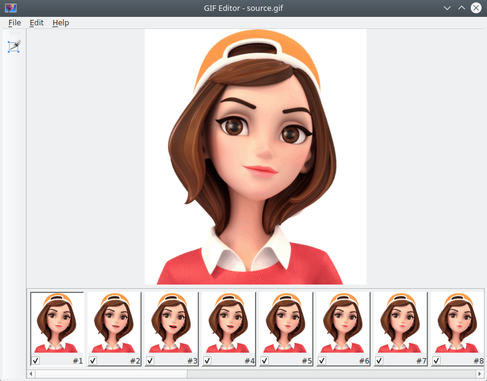
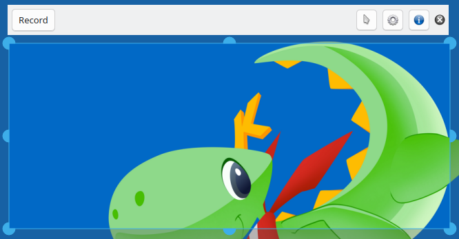

# About

`GIF` editor and recorder for `Windows` and `Linux/X11`.

I consider this tools as a first aid for QA specialists. For UI bug reports it's
an essential to provide good UI example what happens, and with GIF recorder
you can easily record a problem, with mouse clicks, key presses, I think
this is very helpful for a developer to see a real record of a problem in bug report.

In editor QA can add a text (even making an animation is possible) or highlight something
important with rectangle, draw arrow, it's a very easy tool. When editing tool in editor will be
chosen user will see a description text how to use this or that tool, these messages can
be turned off in settings dialogue. In editor GIF player is implemented, with possibility to
pause a GIF, that can be very helpful for developers to see what QA highlighted with
a rectangle or arrow. Really-really easy and helpful tool.

GIF recorder produces not the best quantization for 256 colors in GIF, but this tool
doesn't skip frames, and everything is seen, minor issues in quantization are seen only
on shades, or when difference between colors is not so significant. I use these tools for
my own needs, and believe me the quality is very good for QA tasks. And produced output
files are very small by size, as this is a GIF format, what it was designed.

Try it for yourself. Enjoy.

# License

```cpp
/*
    SPDX-FileCopyrightText: 2026 Igor Mironchik <igor.mironchik@gmail.com>
    SPDX-License-Identifier: GPL-3.0-or-later
*/
```

# Screenshots

|  |  |
| --- | --- |

# Installer

Look at the release page for the installer for some Linux and Windows distributions.

# Building

In dependencies is Qt 6 only. Use CMake or QtCreator to build this project in usual fashion.

# Translating

To translate these applications into your language you need to run

```bash
lupdate6 . ../3rdparty/github-release/src -ts ../translate/gif_{locale}.ts
```

from `src` directory.

Make a translation of that file with Qt Linguist and run in `translate` directory

```bash
lrelease6 gif_{locale}.ts -qm ../src/shared/tr/gif_{locale}.qm
```

And put new line into `src/shared/tr.qrc` file with record about new translation.

With these changes you can do a PR into the repository.